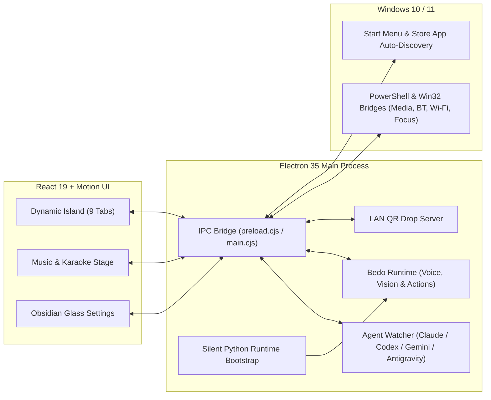

<div align="center">

<br/>


# Bedo

**A weightless Dynamic Island and multimodal AI companion for Windows.**

<br/>

[Download for Windows](https://github.com/bedirhanorseloglu/Bedo-Dynamic-Island-And-AI-Assistant-For-Windows/releases/latest) &nbsp;·&nbsp; [Website](https://bedirhanorseloglu.github.io/Bedo-Dynamic-Island-And-AI-Assistant-For-Windows/) &nbsp;·&nbsp; [Release Notes](https://github.com/bedirhanorseloglu/Bedo-Dynamic-Island-And-AI-Assistant-For-Windows/releases)

<br/>

</div>

---

<div align="center">

https://github.com/bedirhanorseloglu/Bedo-Dynamic-Island-And-AI-Assistant-For-Windows/raw/main/docs/bedo-launch.mp4

<sub><a href="docs/bedo-launch.mp4">Watch Launch Film</a> &nbsp;·&nbsp; Windows 10 & 11 (64-bit) &nbsp;·&nbsp; Open Source</sub>

</div>

---

## Designed to Stay Out of Your Way

Bedo lives quietly along the top edge of your screen. Rendered in translucent **Obsidian Liquid Glass** with spring-physics motion, it expands only when you need it—uniting voice, vision, media, system control, and AI agent telemetry in a single fluid surface.

<br/>

<table>
  <tr>
    <td width="50%" valign="top">
      <h3>Just Say “Bedo.”</h3>
      <p>Wake your desktop hands-free. Start a focus timer, launch apps, adjust volume or brightness, open folders, send WhatsApp messages, and trigger 20+ system actions—without touching your mouse.</p>
    </td>
    <td width="50%" valign="top">
      <h3>Multimodal Intelligence</h3>
      <p>Converse naturally with live voice and camera vision powered by <strong>Gemini</strong>, <strong>OpenAI</strong>, or <strong>Claude</strong>. Switch between six distinct Gemini Live voice personas: <em>Charon, Fenrir, Puck, Aoede, Kore,</em> and <em>Zephyr</em>.</p>
    </td>
  </tr>
  <tr>
    <td width="50%" valign="top">
      <h3>Bedo Buddy</h3>
      <p>Point at anything on your screen—a stack trace, a math equation, a financial table, or foreign text—and get an instant, context-aware explanation right inside the Island.</p>
    </td>
    <td width="50%" valign="top">
      <h3>Live AI Agent Tracking</h3>
      <p>Keep your flow while <strong>Claude Code</strong>, <strong>Antigravity</strong>, <strong>OpenAI Codex CLI</strong>, and <strong>Gemini CLI</strong> work in the background. Bedo notifies you the moment a task finishes or needs approval.</p>
    </td>
  </tr>
  <tr>
    <td width="50%" valign="top">
      <h3>Media & Live Karaoke</h3>
      <p>An ambient glow along the bottom edge adapts to your album art in real time, paired with synchronized lyrics and native Windows SMTC playback controls.</p>
    </td>
    <td width="50%" valign="top">
      <h3>Instant LAN QR Drop</h3>
      <p>Move files between your phone and PC over your local network in seconds. Scan the QR code inside the Island—no cables, no cloud uploads, no friction.</p>
    </td>
  </tr>
</table>

<br/>

### Nine Spaces. One Surface.

> **Home (`ANA`)** &nbsp;·&nbsp; **Music (`MÜZİK`)** &nbsp;·&nbsp; **QR Drop (`DROP`)** &nbsp;·&nbsp; **Bedo AI** &nbsp;·&nbsp; **Focus (`ODAK`)** &nbsp;·&nbsp; **Modes (`MODLAR`)** &nbsp;·&nbsp; **Notes (`NOT`)** &nbsp;·&nbsp; **Calendar (`AJANDA`)** &nbsp;·&nbsp; **Telemetry (`PERF`)**

Choose between **Attached** and **Floating** Island styles, and customize your resting telemetry (*Time, Battery, Wi-Fi, Bluetooth*) to match your workspace.

---

## Get Started in Seconds

1. **Download** the latest `Bedo-Setup-*.exe` from [**GitHub Releases**](https://github.com/bedirhanorseloglu/Bedo-Dynamic-Island-And-AI-Assistant-For-Windows/releases/latest).
2. **Launch** the installer. Bedo anchors itself cleanly at the top of your screen—Python and all runtime dependencies are bundled and configured silently on first start.
3. **Connect** your **Gemini**, **OpenAI**, or **Anthropic** API key in **Settings → AI & Chat** to unlock live voice, vision, and Bedo Buddy.

---

## For Developers

Built with **Electron 35**, **React 19**, **Motion** (spring physics), and **Vite 6**.

```bash
# Install dependencies
npm install

# Start development mode (Vite + Electron)
npm run dev

# Build production Windows installer
npm run dist
```

<details>
<summary><strong>Architecture & Project Structure</strong></summary>

<br/>



```text
├── build/                 # App icons (.ico, .png) & installer assets
├── docs/                  # Interactive marketing website & launch film (GitHub Pages)
├── electron/
│   ├── main.cjs           # Electron lifecycle, IPC, atomic settings & single-instance lock
│   ├── preload.cjs        # Secure contextBridge API
│   ├── bedo-service.cjs   # Voice, vision & action runtime manager
│   └── bedo-runtime/      # Embedded Python assistant runtime, actions & SFX
└── src/
    ├── App.jsx            # Dynamic Island (9 tabs & spring-physics morphing)
    ├── SettingsApp.jsx    # Obsidian Liquid Glass Settings window
    ├── components/        # MusicTabView, BedoStage, RoboEyes, FocusGuard & more
    └── styles.css         # Core Dynamic Island & Liquid Glass design system
```

</details>

---

<div align="center">

<br/>

Crafted by [**Bedirhan Örseloğlu**](https://github.com/bedirhanorseloglu)  
<sub>If Bedo helps your workflow, consider starring the repository or opening an issue with your feedback.</sub>

</div>
