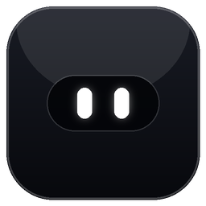
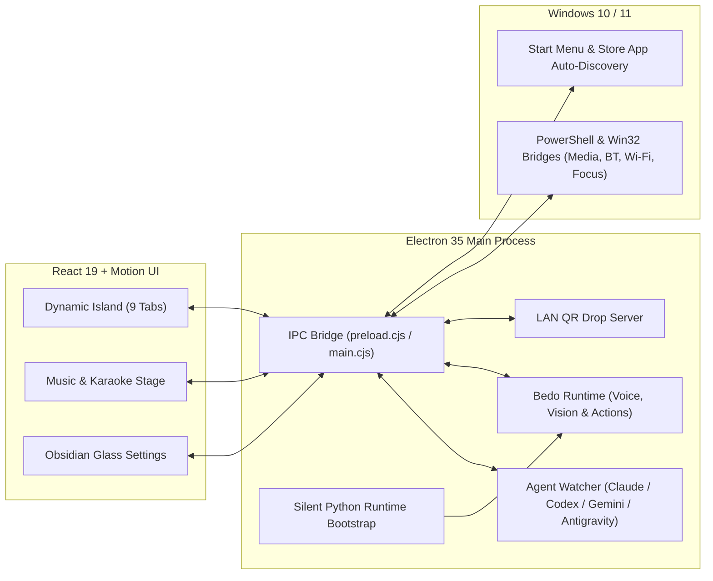

<div align="center">



# Bedo

### The Obsidian Liquid Glass Dynamic Island & Multimodal AI Companion for Windows

<br/>

<a href="https://github.com/bedirhanorseloglu/Bedo-Dynamic-Island-And-AI-Assistant-For-Windows/releases/latest">
  
</a>
<a href="https://bedirhanorseloglu.github.io/Bedo-Dynamic-Island-And-AI-Assistant-For-Windows/">
  
</a>
<a href="https://github.com/bedirhanorseloglu/Bedo-Dynamic-Island-And-AI-Assistant-For-Windows/releases/latest">
  
</a>

<br/><br/>

[](https://www.electronjs.org/)
[](https://react.dev/)
[](https://motion.dev/)
[](https://vite.dev/)
[-0078D6?style=flat-square&logo=windows&logoColor=white)](#)

**Bedo** transforms the top edge of your Windows desktop into a living **Obsidian Liquid Glass Dynamic Island**—uniting hands-free voice AI, live camera vision, screen-aware intelligence, full PC & folder control, synchronized karaoke media, and live AI coding agent tracking in one weightless surface.

</div>

---

## Bedo in Motion

https://github.com/bedirhanorseloglu/Bedo-Dynamic-Island-And-AI-Assistant-For-Windows/raw/main/docs/bedo-launch.mp4

<div align="center">
  <sub><a href="docs/bedo-launch.mp4">Watch Launch Film (MP4)</a> · <a href="https://bedirhanorseloglu.github.io/Bedo-Dynamic-Island-And-AI-Assistant-For-Windows/">Interactive Web Showcase</a></sub>
</div>

---

## What Bedo Does

| Pillar | Capabilities |
| :--- | :--- |
| **Obsidian Liquid Glass** | Translucent glass surfaces (`blur(28px) saturate(180%)`), **Attached** & **Floating** Island styles, customizable resting telemetry (*Time, Battery, Wi-Fi, Bluetooth*), and `Inter` / `Oswald` / `JetBrains Mono` typography. |
| **Hands-Free Voice & PC Control** | Say **“Bedo”** without touching the mouse to open folders and apps, adjust volume or brightness, start focus timers, send WhatsApp messages, and execute 20+ system actions. |
| **6 Gemini Live Voice Personas** | Switch effortlessly between **Charon** *(Default • Deep)*, **Fenrir** *(Crisp • Strong)*, **Puck** *(Dynamic • Youthful)*, **Aoede** *(Soft • Natural)*, **Kore** *(Warm • Calm)*, and **Zephyr** *(Light • Fluid)*. |
| **Bedo Buddy (Screen Intelligence)** | Select or drag onto any math equation, error log, financial table, medical term, or foreign text on your screen for instant context-aware explanations inside the Island. |
| **Media & Live Karaoke** | Bottom-edge ambient glow that adapts dynamically to the playing album cover, paired with real-time synchronized lyrics (`lrclib.net` / NetEase) and SMTC playback controls. |
| **Live AI Agent Tracking** | Monitors **Claude Code**, **Antigravity**, **OpenAI Codex CLI**, and **Gemini CLI** in the background—notifying you the moment a task completes or awaits approval. |
| **9 Native Island Tabs** | **Home (`ANA`)**, **Music (`MÜZİK`)**, **QR Drop (`DROP`)**, **Bedo AI**, **Focus Ruler (`ODAK`)**, **Modes (`MODLAR`)**, **Quick Notes (`NOT`)**, **Calendar (`AJANDA`)**, and **System Telemetry (`PERF`)**. |

---

## Architecture



---

## Getting Started

### For Users (Windows Installer)
1. Download the latest **`Bedo-Setup-*.exe`** from [**GitHub Releases**](https://github.com/bedirhanorseloglu/Bedo-Dynamic-Island-And-AI-Assistant-For-Windows/releases/latest).
2. Run the installer—Bedo launches cleanly at the top edge of your screen.
3. Add your **Gemini**, **OpenAI**, or **Anthropic** API key in **Settings → AI & Chat** to unlock live voice, vision, and Bedo Buddy.
   *(No manual Python or dependency setup required—handled automatically on first launch.)*

### For Developers

```bash
# 1. Install dependencies
npm install

# 2. Run in development mode (Vite + Electron)
npm run dev

# 3. Build production Windows installer
npm run dist
```

---

## Project Structure

```text
├── build/                 # App icons (.ico, .png) & installer assets
├── docs/                  # Interactive marketing website & launch video (GitHub Pages)
├── electron/
│   ├── main.cjs           # Electron lifecycle, IPC, atomic settings & single-instance lock
│   ├── preload.cjs        # Secure contextBridge API
│   ├── bedo-service.cjs   # Voice, vision & action runtime manager
│   └── bedo-runtime/      # Python assistant runtime, actions & SFX
└── src/
    ├── App.jsx            # Dynamic Island (9 tabs & spring-physics morphing)
    ├── SettingsApp.jsx    # Obsidian Liquid Glass Settings window
    ├── components/        # MusicTabView, BedoStage, RoboEyes, FocusGuard & more
    └── styles.css         # Core Dynamic Island & Liquid Glass design system
```

---

<div align="center">
  <sub>Built with craft by <a href="https://github.com/bedirhanorseloglu">Bedirhan Örseloğlu</a></sub>
</div>
