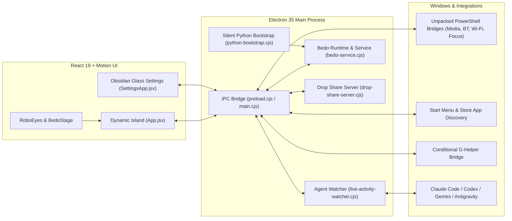

<div align="center">


# Bedo

### The Living Liquid Glass Dynamic Island & Multimodal AI Companion for Windows

<br/>


<sub><em>* Note: The animated visual above is an illustrative concept preview of the Liquid Glass Dynamic Island.</em></sub>

<br/><br/>

[](https://www.electronjs.org/)
[](https://react.dev/)
[](https://motion.dev/)
[](https://vite.dev/)
[](#)
[](#for-everyday-users-zero-setup-zip)

**Bedo** turns the top edge of your Windows desktop into a living, breathing **Liquid Glass Dynamic Island**—combining a **multimodal AI assistant (real-time voice with 6 personas, text chat, and live camera vision)**, **Bedo Buddy** drag-to-screen intelligence, **Mindful Focus Guard**, universal Windows app auto-discovery, and live agent tracking for **Claude Code**, **OpenAI Codex**, **Gemini CLI**, and **Antigravity IDE**.

</div>

---

## Designed Like Native Craft. Built for Everyone.

Most desktop tools feel loud, rigid, or built only for developers. Bedo is crafted around **Apple-inspired Obsidian Liquid Glass** and **zero-friction usability**:

- **Zero Visual Noise When Idle**: Rests cleanly at the top edge as a translucent pill with synchronized **Bedo Eyes** (`RoboEyes`) and optional live resting telemetry (*Time, Battery, Wi-Fi, Bluetooth*).
- **Animated First-Launch Welcome**: On first run, the Island smoothly expands into an animated **Liquid Glass Welcome** card with live `TR / EN` language switching and interactive shortcut guides.
- **Built for Everyday Users & Power Users Alike**: Ships as a single extract-and-run **Portable `.zip`** (`Bedo.exe`)—with automatic background Python runtime bootstrapping (`python-bootstrap.cjs`), automatic Start Menu & Microsoft Store app discovery, and smart hardware adaptation.

---

## Visual & Animated Craftsmanship

<div align="center">
  
  <br/>
  <sub><em>* Representative animated mockup illustrating Bedo's Liquid Glass surfaces; not an in-app screenshot.</em></sub>
</div>

### 1. Obsidian Liquid Glass & Real-Time Island Studio
- **True Translucent Surfaces**: Both the Dynamic Island and the entire Settings window share a neutral obsidian glass canvas (`backdrop-filter: blur(28px) saturate(175%)`) with subtle specular top highlights.
- **Live Island Studio (`Ada`)**: Switch between **Attached** (notch-style) and **Floating** (capsule-style), scale between **Compact / Normal / Large**, dial translucency from **0% to 60%**, and configure **Left / Right Resting Widgets** (*Time, Battery, Wi-Fi, Bluetooth*) with an instant live preview.
- **Adaptive Media Stage**: Album-cover ambient tinting, live synchronized lyrics (`lrclib.net` / NetEase), frosted glass hero clock, and smooth spring-physics morphing.

### 2. Bedo Buddy — Drag-to-Screen Visual Intelligence
- **Drop Bedo Anywhere**: Drag Bedo directly onto any text, code snippet, error dialog, or chart on your screen—or click the screen-scan trigger.
- **Language-Aware Responses**: Automatically responds in the same language as the captured content (or explains code/errors clearly) right inside the Island.

### 3. Mindful Focus Guard (`Odak Koruma`)
- **Intentional Breathing Pause**: Detects distracting apps or websites in the foreground and opens a calming animated breathing countdown (`3s / 5s / 10s`) before you decide to **Turn Back** or **Open Anyway** (with `5m / 15m / 30m` cooldown).
- **Real Logos & Local App Targets**: Features live platform icons (*YouTube, TikTok, Instagram, X, Reddit, Facebook, Netflix, Twitch, Discord*), custom keyword rules, **"Only while Focus Timer runs"** mode, and 1-click selection of any installed PC app.
- **Live Daily Stats**: Tracks *Turned back* vs. *Opened anyway* counts in real time across the Island and Settings.

### 4. Multimodal AI Assistant (Voice, Text & Camera)
- **Real-Time Voice Conversations**: Talk naturally hands-free (`Ctrl+Alt+Space`) with live microphone streaming and instant spoken replies.
- **6 Selectable Voice Personas**: **Charon** *(Deep)*, **Fenrir** *(Crisp)*, **Puck** *(Dynamic)*, **Aoede** *(Soft)*, **Kore** *(Warm)*, and **Zephyr** *(Light)*.
- **Text Chat & Camera Vision**: Rich Markdown rendering (`RoboMarkdown.jsx`) powered by **Gemini**, **Claude**, or **OpenAI**, plus live webcam vision (`webcamActive`).

### 5. AI Agent Monitoring & Universal Hardware Adaptation
- **Live Agent Hooks**: Tracks **Claude Code**, **OpenAI Codex**, **Gemini CLI**, and **Antigravity IDE** (`live-activity-watcher.cjs`), and jumps directly back to the exact IDE window in one click.
- **Universal PC Compatibility**: Automatically detects installed desktop (`.lnk`) & Microsoft Store (`UWP`) apps with native icons, and conditionally enables **ASUS G-Helper Bridge** only when G-Helper is installed—staying completely clean on all other PCs.
- **Silent Background Runtime Setup**: If a PC lacks Python or speech packages, `python-bootstrap.cjs` silently provisions an isolated embeddable Python runtime in `%APPDATA%\bedo\python-runtime` in the background without disturbing the user.

---

## Core Capabilities at a Glance

| Pillar | Highlights |
| :--- | :--- |
| **Dynamic Island** | Animated first-run welcome, `Attached` / `Floating` styles, `0–60%` Liquid Glass translucency, resting telemetry (`Time`, `Battery`, `Wi-Fi`, `Bluetooth`) |
| **Multimodal AI** | Live voice (6 personas), text chat (`Gemini` / `Claude` / `OpenAI`), live webcam vision, and **Bedo Buddy** screen capture |
| **Focus & Notifications** | **Focus Guard** breathing pause + daily stats, DND & focus-aware notification filtering, privacy masking (`Hide` mode), custom sounds |
| **Universal Windows** | Auto-scans Start Menu & Store apps with native icons, SMTC media controls, Bluetooth/Wi-Fi PowerShell bridges, conditional G-Helper OSD |
| **Productivity & Agents** | **Claude Code / Codex / Gemini / Antigravity** live hooks, Google Calendar & Gmail integration, LAN QR file drop (`drop-share-server.cjs`) |
| **Distribution** | Single portable **`Bedo-1.0.0-win.zip`**, crash-safe atomic settings writes, single-instance lock, and `asarUnpack` PowerShell support |

---

## Architecture Overview



---

## Getting Started

### For Everyday Users (Zero-Setup ZIP)
1. Download **`Bedo-1.0.0-win.zip`**.
2. Right-click → **Extract All**.
3. Open the extracted folder and double-click **`Bedo.exe`**.
4. Follow the animated **Welcome Card** on the Island—no terminal or manual Python setup needed.

### For Developers

```bash
# 1. Install dependencies
npm install

# 2. Launch in development mode (Vite + Electron)
npm run dev

# 3. Build production frontend + portable Windows ZIP (release/Bedo-1.0.0-win.zip)
npm run dist
```

---

## Project Structure

```text
├── build/
│   ├── icon.ico                     # Multi-size Windows desktop & executable icon
│   └── icon.png                     # 256x256 Bedo squircle app icon
├── electron/
│   ├── main.cjs                     # Window lifecycle, atomic settings, single-instance lock & IPC
│   ├── preload.cjs                  # Secure contextBridge API (window.twocode)
│   ├── bedo-service.cjs             # Self-contained Bedo voice & vision bridge manager
│   ├── bedo-runtime/                # Bundled Python runtime scripts, wake-word models & SFX
│   ├── python-bootstrap.cjs         # Silent background Python & dependency installer
│   ├── live-activity-watcher.cjs    # Real-time Claude / Codex / Gemini / Antigravity hook watcher
│   ├── drop-share-server.cjs        # Local network file drop & QR sharing server
│   ├── ghelper-service.cjs          # Conditional ASUS G-Helper OSD bridge
│   └── win-*.ps1                    # Unpacked Windows media, Bluetooth, Wi-Fi & focus scripts
├── src/
│   ├── App.jsx                      # Dynamic Island, Welcome Screen, Focus Guard & Bedo Buddy
│   ├── SettingsApp.jsx              # Obsidian Liquid Glass Settings (Home, Agents, AI, Apps, Island, Focus)
│   ├── RoboEyes.jsx                 # Synchronized animated Bedo eyes component
│   ├── HeroClock.jsx                # Frosted glass hero clock
│   ├── AgendaCalendar.jsx           # Google Calendar agenda view
│   ├── settings.css                 # Obsidian Liquid Glass design system for Settings
│   └── styles.css                   # Dynamic Island, HUDs, Focus Guard & welcome animations
└── package.json                     # Vite + electron-builder portable ZIP configuration
```

---

<div align="center">

Crafted with **Electron 35**, **React 19**, **Motion**, and **Obsidian Liquid Glass**.

</div>
