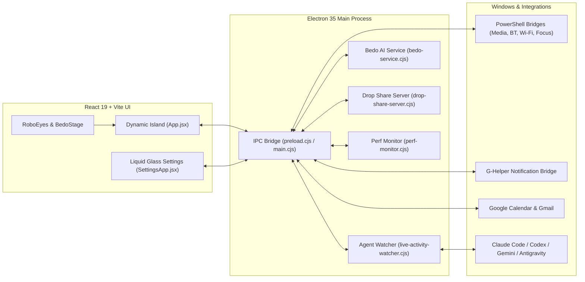

<div align="center">



<sub><em>* Note: The animated visual above is an illustrative concept preview, not a screenshot captured from the live application.</em></sub>

<br/><br/>

[](https://www.electronjs.org/)
[](https://react.dev/)
[](https://motion.dev/)
[](https://vite.dev/)
[](#)

**Bedo** transforms the top edge of your Windows desktop into a living, breathing **Liquid Glass Dynamic Island**—combining a **multimodal AI Assistant (live voice with 6 voice personas, text chat, and camera vision)**, fluid spring-physics micro-interactions, real-time media & hardware HUDs, Google Calendar & Gmail integration, and live activity tracking for **Claude Code**, **OpenAI Codex**, **Gemini CLI**, and **Antigravity IDE**.

</div>

---

## Why Bedo?

Desktop utilities usually feel static, cluttered, or bolted on. Bedo is engineered from the ground up around **Apple-inspired Liquid Glass** aesthetics and **spring-driven motion**:

- **Zero Visual Noise When Idle**: Sits unobtrusively at the top of your screen as a translucent pill with synchronized **RoboEyes** that blink, track, and react to your system.
- **Instant Expansion on Demand**: Hover, click, or trigger a hotkey to morph seamlessly into a full media stage, AI assistant, quick-drop share hub, calendar agenda, or notification center.
- **Built for AI-Native Workflows**: Know the exact moment your coding agent starts thinking, finishes a task, or needs your input—and jump straight back to the exact IDE chat window with a single click.

---

## Visual & Animated Craftsmanship

<div align="center">
  
  <br/>
  <sub><em>* Representative animated mockup illustrating the Liquid Glass UI concepts; not an actual in-app screenshot.</em></sub>
</div>

Every surface in Bedo is designed as layered **Liquid Glass** with physical depth, specular top highlights, and reactive motion:

### 1. Liquid Glass & Specular Depth System
- **Translucent Multi-Layer Surfaces**: Built with `backdrop-filter: blur(...) saturate(160%)`, subtle diagonal light gradients (`linear-gradient(155deg, ...)`), crisp `1px` inner rim highlights (`inset 0 1px 0 rgba(255, 255, 255, ...)`), and soft ambient drop shadows.
- **Adaptive Ambient Lighting**: Surfaces respond to active media artwork, agent states, and Bedo's mood with subtle radial glows rather than harsh flat colors.
- **Unified Design Language**: The collapsed island, expanded popovers, HUD overlays, and the entire Settings experience (`Ana Sayfa`, `Ajanlar`, `AI & Sohbet`, `Bildirimler`, `Ada`) share one cohesive glassmorphism grammar.

### 2. Synchronized RoboEyes & Expressive Bedo Stage
- **Synchronized Blinking & Gaze**: `RoboEyes` renders expressive twin eyes with synchronized blink cycles, state-reactive shapes (idle, listening, thinking, sleeping, happy), and smooth transitions.
- **Bedo Stage**: A dedicated animated presence inside both the island and the Settings companion (`BedoStage`), giving your assistant tangible personality without cluttering your workspace.

### 3. Spring-Physics Motion (`motion` + GPU Compositing)
- **Fluid Morphing**: Island expansions, tab switches (`AnimatePresence`), and card entrances use tuned spring physics (`stiffness`, `damping`, `mass`) for natural momentum.
- **Apple Music-Style Media Player**: Album artwork ambient tinting, frosted glass clock overlay, interactive playback controls, and smooth hover-collapse behavior.
- **Hardware & System HUDs**: Translucent live overlays for Windows volume, brightness, Bluetooth, Wi-Fi, and G-Helper keyboard/mic/Aura events.

---

## Multimodal AI Assistant (Voice, Text & Camera)

Bedo isn't just a passive status bar—it's an always-accessible **multimodal AI companion** built directly into the Dynamic Island:

- **Real-Time Voice Conversations**: Talk naturally to Bedo hands-free with live microphone streaming and instant spoken responses.
- **6 Selectable Voice Personas (`Bedo Voice`)**: Choose the tone that fits your workflow—**Charon** *(Default · Deep)*, **Fenrir** *(Crisp · Strong)*, **Puck** *(Dynamic · Youthful)*, **Aoede** *(Soft · Natural)*, **Kore** *(Warm · Calm)*, or **Zephyr** *(Light · Smooth)*. Switching voices reconnects automatically with zero friction.
- **Text Chat & Rich Markdown**: Type directly inside the island or Settings companion with full Markdown rendering (`RoboMarkdown.jsx`) powered by your choice of **Gemini**, **Claude**, or **OpenAI**.
- **Live Camera Vision**: Toggle your webcam (`webcamActive`) so Bedo can see what you show it in real time—combining voice, text, and visual context in one fluid Liquid Glass interface.

---

## Core Capabilities

| Category | Features |
| :--- | :--- |
| **Multimodal AI Assistant** | Live voice conversations, **6 voice personas** (`Charon`, `Fenrir`, `Puck`, `Aoede`, `Kore`, `Zephyr`), text chat (`RoboMarkdown.jsx`), and live **camera vision** |
| **Dynamic Island Core** | Collapsible top-edge pill, drag-to-reorder/expand interactions, focus protection, custom island sizing & typography |
| **AI Agent Monitoring** | Live hooks & activity stream for **Claude Code**, **Codex**, **Gemini CLI**, and **Antigravity IDE** (`live-activity-watcher.cjs`) |
| **One-Click IDE Focus** | Click any completed agent task in Home or Agents to focus and jump directly to the corresponding IDE window/session |
| **Bedo AI Assistant** | Built-in conversational AI (`bedo-service.cjs`) with Markdown rendering (`RoboMarkdown.jsx`) and multi-provider API key support |
| **Media & System Control** | Windows SMTC media controls, live audio visualizer, volume/radio/Bluetooth/Wi-Fi PowerShell bridges, G-Helper HUD integration |
| **Productivity & Sharing** | Google Calendar agenda (`AgendaCalendar.jsx`), Gmail unread badge & quick mail, local QR / LAN file drop (`drop-share-server.cjs`) |
| **Liquid Glass Settings** | Bento-style **Ana Sayfa** dashboard, **Ajanlar** live hook manager, searchable activity feed, and clean production-ready UI |

---

## Architecture Overview



---

## Getting Started

### Prerequisites
- **Windows 10 / 11**
- **Node.js** (v18+ recommended)
- **npm**

### Installation & Development

```bash
# 1. Install dependencies
npm install

# 2. Launch in development mode (Vite + Electron)
npm run dev
```

### Production Build

```bash
# Build the Vite frontend bundle
npm run build

# Start the Electron app
npm start
```

---

## Project Structure

```text
├── electron/
│   ├── main.cjs                     # Electron window lifecycle, tray, IPC & native bridges
│   ├── preload.cjs                  # Secure contextBridge API (window.twocode)
│   ├── bedo-service.cjs             # AI assistant backend service
│   ├── live-activity-watcher.cjs    # Real-time Claude / Codex / Gemini / Antigravity hook watcher
│   ├── drop-share-server.cjs        # Local network file drop & QR sharing server
│   ├── ghelper-service.cjs          # G-Helper keyboard/mic/Aura bridge
│   └── win-*.ps1                    # Windows media, Bluetooth, Wi-Fi, radio & focus scripts
├── src/
│   ├── App.jsx                      # Dynamic Island main renderer & popovers
│   ├── SettingsApp.jsx              # Liquid Glass Settings app (Home, Agents, AI, Apps, Island...)
│   ├── RoboEyes.jsx                 # Synchronized animated RoboEyes component
│   ├── HeroClock.jsx                # Frosted glass hero clock
│   ├── AgendaCalendar.jsx           # Google Calendar agenda view
│   ├── settings.css                 # Liquid Glass & Glassmorphism design system for Settings
│   └── styles.css                   # Dynamic Island, HUDs, media player & animation styles
└── package.json
```

---

<div align="center">

Built with **Electron**, **React 19**, **Motion**, and **Liquid Glass** craft.

</div>
